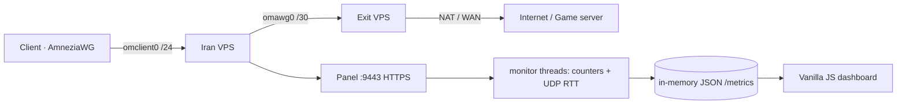

# 1Mobile Gaming Tunnel

پنل وب سبک و امن برای مانیتورینگ زنده تانل گیمینگ مبتنی بر **AmneziaWG**.

> GitHub: `github.com/qasamij/gaming-tunnel`

## ویژگیها

- **نصب از صفر** روی دو سرور Iran / Exit (یا ارتقای نصب قدیمی v1.0/v1.1).
- **کمترین هدر رفت پنل**: صفحه و `/metrics` هیچ فراخوانی `awg` یا `ping` به صورت همزمان نمیکنند. تمام دادهها از worker های background میآیند.
- **گراف زنده ترافیک** چهار دقیقه اخیر (بدون کتابخانه خارجی).
- **سرعت دانلود/آپلود کل و هر کاربر** از اختلاف شمارندههای AWG.
- **لتنسی واقعی تانل** با UDP echo (بدون نیاز به هماهنگی ساعت) + jitter/min/max و packet loss محاسبهشده روی پنجرهٔ چند نمونه. در نبود سرور echo به ICMP تانل برمیگردد.
- **مصرف هر کاربر**، اعتبار روزانه و سهمیه GiB با حذف خودکار peer منقضی.
- **مدیریت کاربران**، دانلود کانفیگ و QR، تغییر IP کانفیگها، بکاپ محلی، عیب‌یابی و ترمیم routing اختصاصی.
- **امنیت**: رمز هششده (Argon2id یا scrypt) + TOTP، محدودیت تلاش، session چرخان، CSRF، CSP، TLS 1.2+، فایلهای `600`، نوشتن atomic.
- **systemd + supervisor هوشمند سلامت**: اگر اینترفیس حذف شود، از کانفیگ و آدرس ذخیرهشده بازسازی میشود؛ اگر زنده باشد ولی handshake کهنه یا UDP probe ناموفق باشد، بعد از ۳ تلاش متوالی تعمیر نرم میکند (Peerهای فعلی حفظ میشوند). تانل به نشست SSH وابسته نیست.
- **جداسازی نصب مخرب از ارتقا**: `fresh` در حضور تانل موجود متوقف میشود و فقط با `FORCE_FRESH=1` روی سرور آزمایشی قابل اجراست.
- **تنظیمات مشترک قبل از نصب**: `fresh-config init` مقادیر مبهمسازی و سابنت را یک بار میسازد و خط `OMAWG_SHARED=...` چاپ میکند؛ سرور دوم با `fresh-config import` همان را میگیرد. بنابراین `fresh exit` و `fresh iran` به ترتیب دلخواه اجرا میشوند.
- **شناسایی واقعی AmneziaWG**: وجود executable کافی نیست؛ نصبکننده حداکثر یک اینترفیس موقت با نام تصادفی `awgchk…` میسازد و کلیدهای مبهمسازی را اعمال میکند؛ هیچ لینک موجودی دستکاری نمیشود و نتیجهٔ موفق ۲۴ ساعت cache میشود تا در سرور کمحافظه آزمایش تکرار نشود. اگر باینری با نام `wg` نصب شده باشد، بهصورت خودکار `/usr/local/bin/awg` به آن متصل میشود (`install.sh awg-check`).
- **وارد کردن ساده کلیدها**: `bash install.sh keys show|import iran|exit` روی هر سرور، بدون نیاز به یادداشت دستی مسیرها.
- **Rollback** کامل سرویسها و مسیر برگشت نصب قدیمی.

## معماری



## شروع سریع از صفر

### 1) نصب پیشنیازها (روی هر دو VPS)

```bash
git clone https://github.com/qasamij/gaming-tunnel.git
cd gaming-tunnel
sudo INSTALL_AWG=1 bash scripts/install.sh deps
```

### 2) تنظیمات مشترک (روی یک VPS، سپس import روی VPS دوم)

```bash
sudo bash scripts/install.sh fresh-config init
# خط چاپشده OMAWG_SHARED=... را به سرور دوم ببرید:
sudo bash scripts/install.sh fresh-config import 'OMAWG_SHARED=...'
```

بدون این مرحله، `fresh exit` مقادیر مبهمسازی Iran را ندارد. `JUNK_COUNT=0` هنگام `init` برای کمترین latency handshake اعمال میشود.

### 3) تولید کلیدها (روی هر دو VPS)

```bash
sudo bash scripts/install.sh keygen iran   # روی سرور ایران
sudo bash scripts/install.sh keygen exit   # روی سرور exit
```

هر دستور کلید عمومی `omawg0.pub` را چاپ میکند؛ آنها را رد و بدل کنید.

### 4) پیکربندی Exit

```bash
sudo bash scripts/install.sh fresh exit
# Iran IP، Iran omawg0.pub، سابنت کلاینتها وارد میشود
```

### 5) پیکربندی Iran

```bash
sudo bash scripts/install.sh fresh iran
# Exit IP، Exit omawg0.pub، IP عمومی ایران و رمز ادمین وارد میشود
```

سپس `https://<IRAN-IP>:9443/` را باز کنید، TOTP ذخیره شده را در authenticator وارد کنید و اولین کاربر را بسازید.

### 6) بررسی پایداری (بعد از ریبوت / بستن SSH)

```bash
sudo bash scripts/install.sh persist
```

جزئیات کامل: [`docs/INSTALL.md`](docs/INSTALL.md) و [`docs/KEYS.md`](docs/KEYS.md)

## ارتقا از نسخه قدیمی

```bash
sudo bash scripts/install.sh monitor   # v1.0/v1.1 -> v1.4
sudo bash scripts/install.sh runtime   # جداگانه، اختیاری
```

برگشت:

```bash
sudo bash scripts/install.sh rollback
sudo bash scripts/install.sh rollback-runtime
```

## نکته مهم درباره لتنسی

- پنل **هیچگونه speed test** انجام نمیدهد؛ سرعتها از شمارندههای real AWG محاسبه میشوند.
- `Jc` (junk packet) فقط روی handshake اثر میگذارد. برای کمترین latency handshake، هنگام اجرای `fresh-config init` پارامتر `JUNK_COUNT=0` بدهید. برای مقاومت DPI پیشفرض `3` است.
- RTT اندازهگیری شده، لتنسی تانل است؛ لتنسی نهایی بازی به exit، ISP و مسیر game server هم بستگی دارد.

## ساختار repository

```text
src/          backend.py, ops.py, monitor.py, web.py, healthcheck.py, passwords.py, keyutil.py, udp_echo.py, static/
scripts/      نصابها، supervisor، rollback و uninstall
systemd/      پنل، supervisor و UDP echo
config/       نمونه network.json و env
tests/        ۵۳ تست واحد (mocked، بدون نیاز به سرور)
docs/         INSTALL / KEYS / TEST-PLAN / QUICK-INSTALL (طرح، پیادهسازی نشده) / PRIVILEGE-SEPARATION / ARCHITECTURE / SECURITY / API / TROUBLESHOOTING
```

## تست

```bash
make test
```

همه تستها بدون network واقعی و با `awg` شبیهسازی شده (mocked) اجرا میشوند.

## وضعیت تست عملی

تاکنون فقط بررسی سورس و تست واحد انجام شده است. قبل از اضافه کردن هر قابلیت تازه، چهار تست عملی روی دو VPS آزمایشی لازم است: نصب صفر، بستن SSH، ریبوت دو سرور و ساخت کاربر همراه با تأیید اینترنت خروجی. جزئیات و جدول نتایج: [`docs/TEST-PLAN.md`](docs/TEST-PLAN.md). تفکیک عملیات مدیریتی از پنل root و نصب آسان تکدستوری [`docs/QUICK-INSTALL.md`](docs/QUICK-INSTALL.md) هم طراحی شدهاند ولی تا بعد از این تستها اجرا نمیشوند: [`docs/PRIVILEGE-SEPARATION.md`](docs/PRIVILEGE-SEPARATION.md).

## هشدار امنیتی

پنل با مجوز root اجرا میشود چون باید `awg`، `ip`، `sysctl` و `iptables` را فراخوانی کند. برای IP متغیر، پورت 9443 را با `DROP` فایروال قفل نکنید؛ از TLS + رمز هششده + TOTP استفاده کنید یا پنل را پشت SSH tunnel ببندید. گواهی self-signed را در صورت تغییر IP تمدید کنید. جزئیات: [`docs/SECURITY.md`](docs/SECURITY.md)

## خلاصه انگلیسی / English summary

A lightweight, HTTPS control panel for a fresh two-server **AmneziaWG** gaming tunnel (Iran + Exit). The dashboard shows live total and per-user download/upload speeds, traffic graphs, traffic usage, quota/expiry, handshakes, and UDP RTT/jitter/windowed packet loss. Page loads and `/metrics` never call `awg` or `ping` synchronously — background workers update an in-memory cache every 2s/5s, keeping ping overhead minimal. Passwords are stored as salted Argon2id/scrypt hashes. Includes systemd units, a health-aware reboot-safe supervisor (fresh handshake + end-to-end UDP probe), a guard that refuses `fresh` on a live tunnel, simple key import on either server, rollback/uninstall scripts, 53 unit tests and CI. Shared obfuscation settings are generated before either server is installed (`fresh-config init` / `import`), so `fresh exit` no longer depends on `fresh iran`. The installer verifies the AWG engine functionally (as some builds name it `wg`), using at most one randomly named throwaway interface and caching the result for low-memory hosts, then publishes a stable `awg` command.

Quick start: `INSTALL_AWG=1 bash scripts/install.sh deps` → `bash scripts/install.sh fresh-config init` (copy `OMAWG_SHARED=...`, then `import` on the other VPS) → `bash scripts/install.sh keygen iran|exit` (exchange `omawg0.pub`) → `bash scripts/install.sh fresh exit` / `fresh iran` (either order) → `bash scripts/install.sh persist`. See [docs/INSTALL.md](docs/INSTALL.md), [docs/KEYS.md](docs/KEYS.md) and the mandatory lab checklist in [docs/TEST-PLAN.md](docs/TEST-PLAN.md).

## لایسنس

MIT — ([LICENSE](LICENSE))
