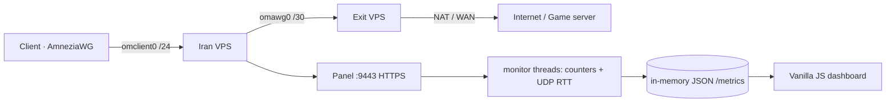

# 1Mobile Gaming Tunnel

پنل وب سبک و امن برای مانیتورینگ زنده تانل گیمینگ مبتنی بر **AmneziaWG**.

> GitHub: `github.com/qasamij/gaming-tunnel`

## ویژگیها

- **نصب از صفر** روی دو سرور Iran / Exit (یا ارتقای نصب قدیمی v1.0/v1.1).
- **کمترین هدر رفت پنل**: صفحه و `/metrics` هیچ فراخوانی `awg` یا `ping` به صورت همزمان نمیکنند. تمام دادهها از worker های background میآیند.
- **گراف زنده ترافیک** چهار دقیقه اخیر (بدون کتابخانه خارجی).
- **سرعت دانلود/آپلود کل و هر کاربر** از اختلاف شمارندههای AWG.
- **لتنسی واقعی تانل** با UDP echo (بدون نیاز به هماهنگی ساعت) + jitter/min/max و packet loss محاسبهشده روی پنجرهٔ چند نمونه. در نبود سرور echo به ICMP تانل برمیگردد.
- **مصرف هر کاربر**، اعتبار روزانه و سهمیه GiB با حذف خودکار peer منقضی.
- **مدیریت کاربران**، دانلود کانفیگ و QR، تغییر IP کانفیگها، بکاپ محلی، عیب‌یابی و ترمیم routing اختصاصی.
- **امنیت**: رمز هششده (Argon2id یا scrypt) + TOTP، محدودیت تلاش، session چرخان، CSRF، CSP، TLS 1.2+، فایلهای `600`، نوشتن atomic.
- **systemd + supervisor**: اگر اینترفیس حذف شود، از کانفیگ و آدرس ذخیرهشده بازسازی میشود، لینک `up` و مسیرها دوباره اعمال میشوند؛ اینترفیس سالم دست نخورده میماند. تانل به نشست SSH وابسته نیست.
- **وارد کردن ساده کلیدها**: `bash install.sh keys show|import iran|exit` روی هر سرور، بدون نیاز به یادداشت دستی مسیرها.
- **Rollback** کامل سرویسها و مسیر برگشت نصب قدیمی.

## معماری



## شروع سریع از صفر

### 1) نصب پیشنیازها (روی هر دو VPS)

```bash
git clone https://github.com/qasamij/gaming-tunnel.git
cd gaming-tunnel
sudo INSTALL_AWG=1 bash scripts/install.sh deps
```

### 2) تولید کلیدها (روی هر دو VPS)

```bash
sudo bash scripts/install.sh keygen iran   # روی سرور ایران
sudo bash scripts/install.sh keygen exit   # روی سرور exit
```

هر دستور کلید عمومی `omawg0.pub` را چاپ میکند؛ آنها را رد و بدل کنید.

### 3) پیکربندی Exit

```bash
sudo bash scripts/install.sh fresh exit
# Iran IP، Iran omawg0.pub، سابنت کلاینتها وارد میشود
```

### 4) پیکربندی Iran

```bash
sudo bash scripts/install.sh fresh iran
# Exit IP، Exit omawg0.pub، IP عمومی ایران و رمز ادمین وارد میشود
```

سپس `https://<IRAN-IP>:9443/` را باز کنید، TOTP ذخیره شده را در authenticator وارد کنید و اولین کاربر را بسازید.

### 5) بررسی پایداری (بعد از ریبوت / بستن SSH)

```bash
sudo bash scripts/install.sh persist
```

جزئیات کامل: [`docs/INSTALL.md`](docs/INSTALL.md) و [`docs/KEYS.md`](docs/KEYS.md)

## ارتقا از نسخه قدیمی

```bash
sudo bash scripts/install.sh monitor   # v1.0/v1.1 -> v1.4
sudo bash scripts/install.sh runtime   # جداگانه، اختیاری
```

برگشت:

```bash
sudo bash scripts/install.sh rollback
sudo bash scripts/install.sh rollback-runtime
```

## نکته مهم درباره لتنسی

- پنل **هیچگونه speed test** انجام نمیدهد؛ سرعتها از شمارندههای real AWG محاسبه میشوند.
- `Jc` (junk packet) فقط روی handshake اثر میگذارد. برای کمترین latency handshake، هنگام نصب `JUNK_COUNT=0` بدهید. برای مقاومت DPI پیشفرض `3` است.
- RTT اندازهگیری شده، لتنسی تانل است؛ لتنسی نهایی بازی به exit، ISP و مسیر game server هم بستگی دارد.

## ساختار repository

```text
src/          backend.py, ops.py, monitor.py, web.py, udp_echo.py, static/
scripts/      نصابها، supervisor، rollback و uninstall
systemd/      پنل، supervisor و UDP echo
config/       نمونه network.json و env
tests/        26 تست واحد (مocked، بدون نیاز به سرور)
docs/         INSTALL / KEYS / ARCHITECTURE / SECURITY / API / TROUBLESHOOTING
```

## تست

```bash
make test
```

همه تستها بدون network واقعی و با `awg` شبیهسازی شده (mocked) اجرا میشوند.

## هشدار امنیتی

پنل با مجوز root اجرا میشود چون باید `awg`، `ip`، `sysctl` و `iptables` را فراخوانی کند. برای IP متغیر، پورت 9443 را با `DROP` فایروال قفل نکنید؛ از TLS + رمز هششده + TOTP استفاده کنید یا پنل را پشت SSH tunnel ببندید. گواهی self-signed را در صورت تغییر IP تمدید کنید. جزئیات: [`docs/SECURITY.md`](docs/SECURITY.md)

## خلاصه انگلیسی / English summary

A lightweight, HTTPS control panel for a fresh two-server **AmneziaWG** gaming tunnel (Iran + Exit). The dashboard shows live total and per-user download/upload speeds, traffic graphs, traffic usage, quota/expiry, handshakes, and UDP RTT/jitter/windowed packet loss. Page loads and `/metrics` never call `awg` or `ping` synchronously — background workers update an in-memory cache every 2s/5s, keeping ping overhead minimal. Passwords are stored as salted Argon2id/scrypt hashes. Includes systemd units, a reboot-safe supervisor, simple key import on either server, rollback/uninstall scripts, 26 unit tests and CI.

Quick start: `INSTALL_AWG=1 bash scripts/install.sh deps` → `bash scripts/install.sh keygen iran|exit` (exchange `omawg0.pub`) → `bash scripts/install.sh fresh exit` → `bash scripts/install.sh fresh iran` → `bash scripts/install.sh persist`. See [docs/INSTALL.md](docs/INSTALL.md) and [docs/KEYS.md](docs/KEYS.md).

## لایسنس

MIT — ([LICENSE](LICENSE))
