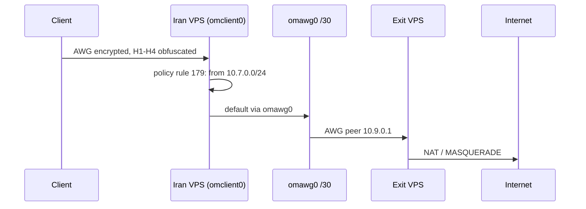

# معماری

## جریان ترافیک



## جری مانیتورینگ (بدون blocking)

```mermaid
flowchart TD
  A[collect_worker · 2s] --> B[awg show transfer / handshakes / allowed-ips]
  C[probe_worker · 5s] --> D[UDP echo to 10.9.0.1:5355]
  B --> E[(in-memory latest/history)]
  D --> F[(in-memory latency + jitter)]
  E --> G[/metrics]
  F --> G
  G --> H[app.js · canvas + tables · 2s refresh]
  I[HTTP handler] -->|no subprocess| G
```

نکتهها:

- `web.py` موقع لود صفحه فقط HTML ثابت + توکن CSRF را میدهد.
- `GET /metrics` تنها `json.dumps` از cache است.
- `create/enable/disable/delete/diagnose` تنها زمانی که کاربر دکمهای را فشار دهد، فرمان اجرا میکنند.
- `history` یک `deque(maxlen=120)` است یعنی 4 دقیقه با نمونه 2 ثانیهای.
- `jitter` میانگین انحراف مطلق از mean آخرین 30 RTT است.

## شمارندهها و جهت سرعت

`awg show <iface> transfer` خروجی `pubkey rx tx` میدهد:

| طرف سرور | معنی | برچسب پنل |
|---|---|---|
| `rx` | بایتها از peer به سرور | **آپلود کاربر** |
| `tx` | بایتها از سرور به peer | **دانلود کاربر** |

اگر شمارنده کاهش یابد (peer بازسازی شود)، نمونه آن دوره `null` میشود تا گراف جهش نکند.

## فایلها و state

| مسیر | محتوا | مجوز |
|---|---|---|
| `/etc/1mobile-panel/` | password (هش Argon2id/scrypt), totp-secret, tls.*, users.json, network.json, backup/ | 700 |
| `/etc/1mobile-runtime/` | role, keys/, `<iface>.conf`, `<iface>.addr`, obfuscation.txt, exit.json | 700 |
| `/etc/1mobile-client/server.pub` | کلید عمومی omclient0 | 644 |
| `/opt/1mobile-web-v13/` | کد پنل + static/ + healthcheck.py, awgdetect.py | 755 (کدها 600 بجز udp_echo.py) |
| `/opt/1mobile-runtime/` | runtime.sh, supervise.sh, apply-iface.sh, keyutil.py, awgdetect.py | 700 |
| `/usr/local/bin/awg` | پیوند به باینری تأییدشدهٔ AmneziaWG (`awg` یا `wg`) | 755 |

## بازیابی بعد از ریبوت

`1mobile-runtime.service` فرایند `supervise.sh` را نگه میدارد. علاوه بر بازسازی اینترفیس گم شده، هر ۶۰ ثانیه `healthcheck.py` را اجرا میکند؛ اگر handshake کهنه یا UDP probe ناموفق باشد، بعد از ۳ تلاش متوالی `apply-iface.sh` + `runtime.sh` را با حفظ Peerها اعمال میکند.

برای بازسازی اینترفیس گم شده:

1. `amneziawg-go <iface>` برای ساخت لینک،
2. `awg setconf` بر روی کانفیگی که خطوط `Address/DNS/MTU/Table` آن حذف شدهاند (wg-quick معمولاً اینها را جداگانه اعمال میکند)،
3. خواندن آدرسها از `<iface>.addr` و `ip addr add`، سپس `ip link set up`،
4. اجرای مجدد `runtime.sh` برای policy routing (Iran) یا route/NAT (Exit).

به همین دلیل `awg showconf` (که آدرسها را چاپ نمیکند) نمیتواند باعث از دست رفتن آدرسها بعد از ریبوت شود.
